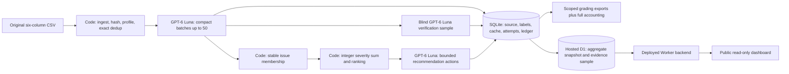

# Spotify review evidence — 100,000-review partial run

**PARTIAL RUN: 100,000 reviews classified. All 660,622 original rows ingested and profiled.** This meets the assignment's amended minimum of at least 100,000 classifications; it is not full-corpus classification. The original hosted prompt remains in production.

- **Public dashboard:** [Spotify Review Evidence](https://spotify-review-evidence.tess-rubin.chatgpt.site/) — no login or API key required. The deployed backend reads saved data from Cloudflare D1; browsing makes no model calls.
- **Downloadable grading/evidence:** [download the sanitized grading/cost ZIP](https://github.com/tess-rubin/spotify-review-evidence/releases/download/final-partial/spotify-public-evidence.zip). Extract into this repository to inspect `grading/`, the hosted cost evidence and full-source accounting.
- **Decision memo:** [MEMO.md](MEMO.md). [Run summary](reports/run-summary.json), [original evaluation](reports/evaluation-summary.json), [actual checker report](reports/check_submission.partial.json).

| Saved outcome | Count |
|---|---:|
| Original source rows ingested/profiled | 660,622 |
| Hosted classifications | 100,000 |
| Direct classifications | 78,992 |
| Direct exact-text cache reuses | 21,008 |
| Empty texts quarantined | 13 |
| Nonempty source rows outside the partial analysis | 560,609 |
| Historical Gemma classifications, **separate** | 66,577 |

The analysis cohort is the first 100,000 nonempty source-order records excluding original golden IDs and exact golden texts. Duplicate texts retain separate original IDs and count separately in aggregates. Full-source completion is approximately 15.14% of nonempty reviews; all source IDs remain accounted for. This self-selected, historical source-order cohort does not establish population prevalence, causal product impact, confirmed churn or revenue at risk.

## Rubric → evidence

The [assignment rubric](https://docs.google.com/document/d/1PUFw56OGxqbUxiFm0vKtsWX8ac8633BgOlCSGa3TgLA/edit) uses deliverable quality 4, testing/evaluation 3 and working result 3. These links show evidence, not a self-awarded grade.

| Criterion | Evidence and practical limits |
|---|---|
| D1: accessible code, setup and artifacts | Commands below; `.env.example`; public dashboard; `final-partial` release. Private human answers require a secure instructor handoff and are excluded from GitHub. |
| D2: architecture, schema and provenance | Diagram below; [labels](LABELS.md); [hosted adapter](pipeline/hosted.py); [frozen configuration](pipeline/configs/hosted-luna.json); exact source row hashes and direct cache links in `grading/records.jsonl.gz`. |
| D3: memo numbers, calculations and source evidence | [Memo](MEMO.md); `grading/claims.csv`, `ranking.csv`, `membership.csv`; [source-to-claim trace](reports/review-trace.json). |
| D4: coherent recommendation, alternatives and limitations | Memo prioritizes playback and compares usability and billing; deterministic partial cohort and diagnostic accuracy limitations are explicit. |
| T1: 50 human labels, comparisons, failure analysis | [Aggregate original evaluation/confusions](reports/evaluation-summary.json); original expected labels and per-review comparisons retained privately. Original agreement: 74% topic, 80% intent, 66% severity; MAE 0.38; 22/50 exact triples. |
| T2: blind verifier, planted errors and injection | Saved independent ten-review blind verification in release; [actual hosted security check](reports/security-check.json): three injection cases passed and three planted fields detected against saved blind predictions. Same-model verification is a consistency check, not ground truth. |
| T3: actual cold/warm pilot, calculator, recovery/spend controls | [Cost evidence](cost/README.md), [portable real usage](cost/hosted-measured.json), [dated rates](cost/hosted-rates.json), [calculator](cost/hosted_calculator.py); actual SIGINT recording/checkpoints in release; [offline tests](reports/tests.txt). |
| W1: ingestion, coverage and classification | Full-file `grading/ingestion.json`; 100,000 completed records with no missing/duplicate/invalid IDs within the declared cohort; full 660,622-row accounting separately in release. |
| W2: runnable staged program, bounded calls, handoffs, resume | [Arbitrary CSV entrypoint](pipeline/hosted_csv.py); [hosted runner](pipeline/hosted.py); saved SQLite/call artifacts and real 51→155 SIGINT resume with zero repeated completed IDs. |
| W3: reproducible ranking and usable deployed system | [Ranking replay](pipeline/rank_export.py); public Worker/D1 dashboard, eight ranked issues/recommendations and 400 inspectable evidence records. [Live/database consistency](reports/dashboard-consistency.json). |

## Architecture and roles



Code owns IDs, hashes, validation, queues, caching, arithmetic, scope and budgets. The model supplies topic, intent, severity, sentiment and needs_review. Code adds the full unchanged source text as evidence and `entities: []`: **entities were not extracted**. Full-text quotes establish provenance, not semantic correctness. Stars/metadata never enter classification inputs. Prompt/schema/settings hashes invalidate results when configuration changes.

Each complaint/cancellation has one stable `issue-<topic>` membership. Priority is integer `severity_sum`, exactly count × mean severity; sort descending then ascending issue ID. Means use six-decimal half-up rounding. Grouping/ranking remain code. The supplied checker additionally requires a successful model `group` role; a bounded issue-naming call is pending user authorization. No fake call is logged.

Memo generation receives saved aggregates and two source examples per issue. The model selects an evidence reference; code binds the exact original ID and quote. The repaired validator allows source-grounded device identifiers such as Galaxy M51 while rejecting unsupported numeric claims. All eight final citations match source records. Prose grounding still needs human judgment.

The dashboard stores all final issue aggregates/recommendations, the coverage snapshot and a 400-review evidence sample in D1. The complete 100,000 classified records and 660,622-row accounting are in the downloadable export, not all hosted as searchable D1 rows. Its HTTP API and browser were tested against SQLite ranking/citations. The 66,577 old Gemma rows are never merged into hosted coverage.

## Evaluation and inspected failures

The production profile was frozen before the original golden score. All 50 predictions are valid. Sentiment/needs_review lack completed human gold answers, so their human accuracy is not invented. The blind verifier agreed on all ten sampled topic/intent/severity triples; seven sentiment values and one review flag differed. Original classifications were retained.

One trace: review `1b326d48-c751-4e4a-9d06-efcfbdce5cfe` has the exact quote “It works, not for every country though.” Its original source hash, successful enrichment request, blind verification, `issue-other` membership and `issue-other-severity_sum` claim are in [review-trace.json](reports/review-trace.json). Both predictions assigned other/complaint/severity 3; the original marked it for review, while the verifier did not. This disagreement remains visible rather than being silently corrected.

Original errors include topic boundaries, complaint/request interpretation, multilingual ambiguity and severity calibration. No star-derived severity or label edits were used. At the user's temporary request, one golden-error-informed candidate scored 80%/82%/76% and 28/50 triples; this is development evidence, not independent accuracy. The user reversed that instruction: the candidate was rejected and never used for the 100,000 cohort. A fresh, pre-frozen synthetic check passed 23/24 triples; 50 fresh real reviews were reserved for blind labels and remain unevaluated. Future prompt changes must use checkpoint_500.csv or analysis_10000.csv and a fresh final check.

The memo repair addresses two observed failures: an original response mistyped a review ID; another valid source-specific action mentioned M51 and was rejected by an overbroad digit ban. Both failures and their reported usage remain saved. Structured evidence references now remove the need to regenerate IDs/quotes.

## Measured costs, time and controls

The unchanged `cost_100.csv` cold pilot used two 50-review requests: **3,325 input / 2,872 output tokens**, or **33.25 / 28.72 per review**. Enrichment cost was $0.001770 after conservative per-call rounding; verification/memo brought the original pilot to $0.002483. Cold classification took 22.814 seconds; warm classification took 0.004329 seconds with zero enrichment calls, and downstream warm replay also made zero calls.

The completed cohort's classification wall span was **18,463.696 seconds (5.13 hours)**, including the experiment pause; summed classification HTTP time was 17,747.548 seconds. These are measured durations, distinct from the earlier 7.3-hour no-reuse projection. [Final run summary](reports/run-summary.json) and `cost/hosted-final-summary.json` distinguish measurements and projections.

All project hosted calls share one persistent ledger, including pilots, abandoned experiments, security checks, retries, verification and memo. The strict ceiling is **$4.90**, including actual usage-based costs plus outstanding worst-case reservations. Recorded project API usage cost is **$1.408096**, plus **$0.006007** held for unavailable usage, below the $4.90 cap. See `reports/run-summary.json`. No provider invoice reconciliation is claimed. Two interrupted requests have unavailable token usage and **$0.006007 held**, never invented as zero. The strict known-usage `calls.jsonl` adapter and separate `unsettled_attempts.jsonl` together retain all relevant attempts.

Standard rates checked October 18: $0.10 input, $0.01 cached input and $0.50 output per million tokens; [official pricing](https://developers.openai.com/api/docs/models/gpt-6-luna). Requests use reasoning `none`, standard tier, one worker, capped output, one invalid-output retry and bounded rate-limit retries. A byte-based worst-case input reservation plus capped output is made atomically before dispatch. Unknown charges remain held. A reservation overrun records actual usage and blocks further dispatch. No stronger fallback is enabled. Existing hardware, ordinary electricity and existing subscriptions are excluded from the user's budget; no new paid hosting was purchased.

The hosted 500/10,000 development gates were not separately executed in the deadline revision. Historical local experiments are separate and do not substitute for same-profile hosted measurements. Full-corpus scenarios remain projections, never claims of completion.

## Setup, offline replay and explicit paid commands

Python 3.10+ standard library; Node 18+ for Worker syntax/build checks. No key or network is needed for saved-output ranking or cost replay. Raw CSVs, private human answers, databases, raw attempts and generated seeds are excluded from Git commits. Download/extract the release for saved grading evidence; obtain the original assignment source separately. See [source manifest](supplied/manifest.json) and [source instructions](supplied/README.md). Full original CSV SHA256: `1fc85de68a304dd8978b537cfa58793d5f41cbaf417fa32cb53899f83a2fcef6`.

```sh
python3 cost/hosted_calculator.py
python3 cost/hosted_calculator.py --volume 200000 --rate-multiplier 2
python3 pipeline/rank_export.py --records grading/records.jsonl.gz --membership grading/membership.csv --out /tmp/ranking.csv
python3 -m unittest discover -s tests -p test_hosted.py
```

Recorded pilot data remain unchanged when volume changes; doubling API rates doubles the API subtotal without altering recorded tokens/time. Alternate replay writes `cost/hosted-replay.json`. Full workspace tests require the private evaluation/development fixtures; the saved results are linked above.

Profile any six-column source CSV without paying, or explicitly execute all stages:

```sh
python3 pipeline/hosted_csv.py path/to/reviews.csv
python3 pipeline/hosted_csv.py path/to/reviews.csv --execute-paid --spend-cap 4.90
```

Only explicit execution loads the ignored local `.env`. Use `OPENAI_API_KEY`; never paste keys into chat/code/arguments/logs. Human-answer-bearing CSVs are rejected. Credentials failing authentication stop the run. On macOS, TLS uses the system certificate bundle with verification enabled. Bulk execution requires a matching below-$4 projection and the shared hard cap.

For the supplied pilot and partial workflow:

```sh
python3 pipeline/hosted.py pilot --execute-paid --spend-cap 4.90
python3 pipeline/hosted_finish.py pilot --execute-paid --spend-cap 4.90
python3 cost/hosted_calculator.py --prepare-from-pilot
python3 pipeline/hosted.py partial --execute-paid --spend-cap 4.90 --phase resume
python3 pipeline/export_partial.py
```

Do not rerun these paid commands merely to inspect results. Saved records are reused only under identical configuration. Per-batch transactions, direct provenance, committed-success recovery, database initialization checks and the global lease prevent ordinary repeat work. The SIGINT demo saved 51 then 155 reviews with zero repeated completed IDs. Its recording, snapshots and checks are in the release.

## Honest checker scope and completeness

`grading/analysis_scope.csv` preserves the 100,000 original six-field source rows. The **unmodified** supplied checker can validate that explicit cohort against the complete source:

```sh
python3 supplied/check_submission.py reference --full supplied/spotify_reviews_18months.csv --analysis grading/analysis_scope.csv --out data/hosted/partial-reference.json
python3 supplied/check_submission.py check --reference data/hosted/partial-reference.json --submission grading --out self-check.json
```

Current partial report: all 100,000 records valid; no missing/duplicate IDs, bad hashes, invalid cache provenance, membership/ranking or claim errors. The remaining flag is the required model `group` role, pending authorization. This is **review_required**, not a claimed pass. Unknown usage is visibly preserved outside the checker's integer-only known-usage adapter.

The separate full-source accounting export retains all 660,622 IDs and the 13 empty-text reasons. Its [full-scope report](reports/check_submission.full-accounting.json) honestly flags unfinished classification and the same missing role. The full-source coverage-point candidate is 0.4908 under the supplied formula; the cohort's 100% validation is not a claim of full-source classification. The amended assignment accepts at least 100,000 reviews, but an instructor determines the grade.

## Public access and private evidence

The dashboard is public and needs no grader invitation. GitHub source and the sanitized release are intended for signed-out inspection. Human golden answers and per-review human comparisons are intentionally excluded from public GitHub and its release; provide the grader's email for a private evidence handoff. The final public repository URL is the course submission deliverable; the student must submit it through bCourses.
